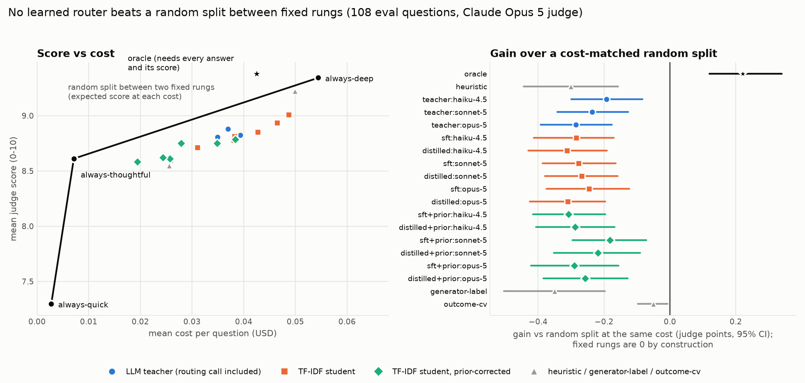

# router-distill

An LLM router decides, per question, whether a cheap fast model, a mid model or the strongest model should answer. This repo tests whether that decision can be distilled into a classifier that costs nothing to run, and whether the strongest model is also the best teacher for it.

<!-- headline:start (generated by scripts/report.py; edit the script, not this block) -->
**Result: on this eval set every LLM router and every distilled student does worse than splitting traffic at random between two fixed models at the same average cost, and an operating point chosen by cross-validation does not change that.** The cause is per-question cost. Hard questions get long answers, so a deep answer costs $0.1599 on the clean-deep slice against $0.0044 on clean-quick (36x). The questions the teachers send to deep buy 8.0-10.2 judge points per extra dollar over the thoughtful answer, against 24.0-26.3 on the questions they keep off deep. The random split buys deep answers on cheap questions too, so a router that routes by difficulty loses on this metric even though its choices are informative. The first version of this repo reported that "every student beats its teacher"; that came from a metric that ignores cost, and it does not survive a cost-aware comparison.
<!-- headline:end -->



## Research questions

1. **Q1, imitation.** Can a TF-IDF + logistic-regression classifier (microseconds per query, no API call) reproduce an LLM router's tier choices?
2. **Q2, best teacher.** If you distill the router from the model that answers best, do you get the best router? A strong model might rate everything "easy" and give labels that discriminate less than a mid-tier model's.

<!-- results:start (generated by scripts/report.py; edit the script, not this block) -->
## Answers so far

| question | answer | evidence |
|---|---|---|
| Q1 | Partly. Students agree with their own teacher 76%-81% of the time in cross-validation on the synthetic training pool but only 49%-71% on the curated eval questions; the three teachers agree with each other 90%-94%. A pretrained sentence encoder in place of TF-IDF does no better (57%-72%). | [REPORT.md section 3](REPORT.md#3-imitation-fidelity-q1) |
| Q2 | Not answerable with this data. The three teachers label the eval set almost identically, and no teacher or student comparison survives a Holm correction for the 18 comparisons made. Which teacher's student wins most training-set resamples flips with the training target (SFT: opus-5, distillation: sonnet-5). Whether a student beats its teacher also depends on how it is regularised. Refitting the students at every C from 1 to 100 and with v0.1's fixed-step trainer (36 refits) moves student-minus-teacher gain from -0.16 to +0.17. Nominally better than their teacher (unadjusted p < 0.05): `sft:opus-5` with the v0.1 trainer, `distilled:opus-5` with the v0.1 trainer; they send 77%-81% of questions to deep. 4 refits are nominally worse. None survives a Holm correction across the refits. | [REPORT.md section 4](REPORT.md#4-is-the-best-solver-the-best-teacher-q2) |
| Does routing help at all here? | No. Every teacher and student scores 0.18-0.35 points below a cost-matched random split, with every 95% interval below zero. Only the per-question oracle, which needs every answer and its score, beats it (+0.22). Removing the teachers' routing call leaves them at -0.23 to -0.18; the loss comes from which questions they send to deep, which are the ones whose deep answers cost most. | [REPORT.md section 1](REPORT.md#1-every-router-against-the-random-split) |

## Main results

108 curated questions, each answered by all three rungs and scored 0-10 by Claude Opus 5. Intervals are 95% paired-bootstrap intervals over questions. Costs are list prices as of 2026-10-18 and include the teacher's own routing call.

| router | sent to quick / thoughtful / deep | mean score [95% CI] | $ per question | gain vs random split [95% CI] |
|---|---|---|---|---|
| always-quick (Haiku 4.5) | 108 / 0 / 0 | 7.30 [6.94, 7.64] | 0.0028 | 0 by construction |
| always-thoughtful (Sonnet 5) | 0 / 108 / 0 | 8.61 [8.43, 8.79] | 0.0071 | 0 by construction |
| always-deep (Opus 5) | 0 / 0 / 108 | 9.34 [9.16, 9.50] | 0.0544 | 0 by construction |
| oracle (needs every answer and its score) | 13 / 29 / 66 | 9.38 [9.22, 9.52] | 0.0425 | +0.22 [+0.12, +0.34] |
| regex heuristic | 27 / 67 / 14 | 8.60 [8.36, 8.82] | 0.0260 | -0.30 [-0.44, -0.16] |
| teacher: Haiku 4.5 | 27 / 49 / 32 | 8.88 [8.69, 9.06] | 0.0370 | -0.19 [-0.30, -0.08] |
| teacher: Sonnet 5 | 26 / 58 / 24 | 8.81 [8.60, 8.99] | 0.0349 | -0.24 [-0.34, -0.13] |
| teacher: Opus 5 | 27 / 55 / 26 | 8.82 [8.62, 9.01] | 0.0393 | -0.28 [-0.39, -0.18] |
| SFT student of Haiku | 29 / 20 / 59 | 8.94 [8.69, 9.15] | 0.0465 | -0.28 [-0.41, -0.17] |
| distilled student of Haiku | 27 / 43 / 38 | 8.79 [8.56, 8.99] | 0.0393 | -0.32 [-0.44, -0.20] |
| SFT student of Sonnet | 27 / 47 / 34 | 8.81 [8.59, 9.02] | 0.0385 | -0.28 [-0.39, -0.17] |
| distilled student of Sonnet | 19 / 67 / 22 | 8.71 [8.51, 8.91] | 0.0310 | -0.27 [-0.38, -0.16] |
| SFT student of Opus | 34 / 4 / 70 | 9.00 [8.75, 9.22] | 0.0498 | -0.27 [-0.40, -0.15] |
| distilled student of Opus | 31 / 36 / 41 | 8.81 [8.56, 9.05] | 0.0427 | -0.35 [-0.47, -0.22] |
| student trained on oracle tiers (10-fold CV) | 1 / 17 / 90 | 9.22 [9.03, 9.39] | 0.0499 | -0.05 [-0.10, -0.01] |

[REPORT.md](REPORT.md) has every row (including prior-corrected students and a student trained on the question generator's intended tier), per-slice regret, the threshold sweeps, the measurement checks and the sensitivity analyses.

### How to read "gain vs random split"

Take the Sonnet 5 teacher. It spends $0.0349 per question, including its own labelling call. The same budget buys a router that ignores the question and sends a random 59% of traffic to always-deep and the rest to always-thoughtful; that mix scores 9.04 on average. The Sonnet teacher scores 8.81, so its gain is -0.24: it spends the money worse than a coin flip would. A gain clearly above zero means a router's per-question choices buy score more cheaply than the split. A gain clearly below zero, as here, means the choices are informative too, but they line up with answer cost: the questions sent to deep are the ones whose deep answers are longest and dearest ([REPORT.md section 1](REPORT.md#why-the-routers-lose)). Regret (the oracle's score minus the router's) ignores cost, so on regret alone always-deep looks nearly perfect.
<!-- results:end -->

## What changed since v0.1

The first run (August 2026, commit `a1de1be`) reported that every student beat its own teacher, for example an Opus SFT student with regret 0.21 against 0.56 for the Opus teacher. Three things were wrong:

1. **Regret rewards picking deep.** The deep rung ties or beats both cheaper rungs on 105 of 108 questions, so regret ranks routers by how often they choose deep (REPORT.md summary gives the rank correlation). The v0.1 students sent 35-79% of questions to deep against the teachers' 22-30%.
2. **Sonnet 5 was priced at $3/$15.** It launched at $2/$10 as introductory pricing that became the standard price, so the run was billed at $2/$10 and the thoughtful rung costs $0.0071, not $0.0107.
3. **Eval questions leaked into training.** Two eval questions appeared verbatim in the synthetic pool, plus a near-copy, three paraphrases and one question posing the same design task. They are now excluded (`data/train_exclusions.json`). The generator rejects copies, and `make leaks` lists likely paraphrases by character n-grams and by sentence-encoder similarity for a person to check; one paraphrase (syn-0439, a sourdough starter that smells of nail polish remover) was found that way in review.

The students also changed, but that change does not explain v0.1's result. v0.1 trained them with 300 steps of fixed-step gradient descent, which stops well short of convergence; they now use a converged logistic regression with C chosen by 5-fold cross-validation, plus a prior-corrected variant. Refit on the leak-free pool and scored on the cost-aware gain, v0.1's fixed-step students of Opus do better than the converged ones (-0.12 and -0.14 against -0.27 and -0.35) and nominally better than the Opus teacher (+0.17 [+0.05, +0.28], p = 0.004, and +0.14 [+0.02, +0.25], p = 0.017, unadjusted; neither survives a Holm correction across the 36 refits). They send 77-81% of questions to deep. The converged SFT students of Haiku and Opus also lean toward deep (55% and 65%) while matching their training labels exactly, so that lean is not under-fitting. Whether a student beats its teacher depends on how it is regularised, and C is chosen for imitation, not for routing value (REPORT.md section 4, "Student regularisation").

The committed data (answers, judge scores, labels) is unchanged apart from a backfilled `max_tokens` field; every number above is recomputed from it.

## Method

1. **Eval set.** 108 hand-written questions in five slices: clean-quick (single facts), clean-thoughtful, clean-deep (proofs, designs), ambiguous ("Why did my deploy fail?") and out-of-distribution (hobbies, finance, health). `data/questions.jsonl`.
2. **Outcome grid.** Every question is answered at three rungs: quick = Claude Haiku 4.5, thoughtful = Claude Sonnet 5 at medium effort, deep = Claude Opus 5 at high effort. Claude Opus 5 scores each answer 0-10 without being told which model wrote it.
3. **Teachers.** Each of the three models reads each question and returns a probability over the three tiers. A teacher used as a live router sends the question to its most likely tier (ties go to the more capable tier) and pays for its own call.
4. **Students.** Claude Opus 5 generated a pool of synthetic questions (468 after removing eval leaks); each teacher labelled them. A student is TF-IDF features (word 1-2-grams and character 3-5-grams) into multinomial logistic regression. The SFT student trains on the teacher's top tier, the distilled student on its full distribution; the regularisation strength is picked by 5-fold cross-validation on the pool.
5. **Scoring.** Every router is scored on the 108 eval questions against the cost-matched random split, with paired bootstrap intervals (10,000 resamples) and Holm-adjusted p-values for the family of teacher comparisons. Imitation is measured as top-tier agreement and KL divergence against the teacher.

The tier names (quick / thoughtful / deep) and the regex baseline come from two of the author's other projects, Bonsai and Mahogany, which route requests between models. Nothing here depends on them.

## Limitations

- **Small eval set.** With 108 questions a 95% interval on the difference between two routers is about +/-0.11 points; +/-0.05 would need over 500 questions (REPORT.md section 6). Each cell has one answer and one judge pass, so answer sampling noise and judge test-retest noise are not measured.
- **One judge, and it is not neutral.** Claude Opus 5 judges its own deep-rung answers, wrote the training questions, and is one of the teachers. Self-preference is unmeasured. Length bias is not measured directly: the deep answer is the longest on 91 of 108 questions, so the raw within-question correlation between log length and score (Spearman rho 0.61) mostly reflects which rung wrote the answer; with question and rung means removed it is 0.19 [0.03, 0.31] (questions resampled as clusters), and within a rung across questions it is negative or near zero. Scores bunch at 8-10, there are no reference answers, and the rubric does not say how to score a justified request for more context on the ambiguous slice.
- **Uneven generation settings.** 303 answers ran with `max_tokens` 4,000; 21 that had truncated were re-run at 16,000. None of the kept 4,000-token answers hit the cap, but one deep answer (cd-018) is still cut off at 16,000 and scored 4. Dropping it changes no conclusion (REPORT.md section 7).
- **Train and eval differ.** The synthetic questions are about 2.4 times as long as the curated ones (median 193 vs 80 characters) and labelled deep far more often. This is the likely main reason eval agreement trails cross-validation agreement.
- **The prior correction peeks.** The `+prior` students are reweighted to their teacher's tier distribution on the eval questions (three numbers). In production you would estimate it from a teacher-labelled sample of live traffic.
<!-- tuned:start (generated by scripts/report.py; edit the script, not this block) -->
- **Tuned operating points.** REPORT.md section 2 also picks each router's thresholds on the eval set itself. One in-sample point has a 95% interval above zero: `sft:opus-5` (two thresholds, +0.07 [+0.002, +0.14]). That interval does not account for choosing the best of 1,782 candidate operating points per router, so it is not evidence. Choosing the point by 10-fold cross-validation instead gives -0.39 to -0.01, and no interval is above zero.
<!-- tuned:end -->
- **Not deterministic from scratch.** Sonnet 5 and Opus 5 reject a temperature setting, so re-running the API steps gives different answers, scores and labels. The offline analysis is deterministic.
- **Latency** in REPORT.md was measured with four concurrent requests and SDK retries, so it is indicative only.

## Reproduce

Requires [uv](https://docs.astral.sh/uv/) and Python 3.12. No API key is needed for the analysis.

```
uv sync
make test        # offline tests, about 2 s
make reproduce   # retrain the 6 students, rebuild REPORT.md, results/metrics.json, this README's generated blocks and the figure (about 2 min on 4 cores, no API calls)
make check       # rebuild and fail if REPORT.md, README.md's generated blocks or results/metrics.json differ from HEAD
make embed       # optional: encoder students (installs torch; needs all-MiniLM-L6-v2 in the Hugging Face cache)
make leaks       # optional: list training questions that may paraphrase an eval question, for a person to review
```

CI runs `make lint`, `make test` and `make check` on every push. On macOS the rebuild is byte-identical. On Linux everything matches except the training-set bootstrap table (section 4 of REPORT.md), whose 300 refits on resampled data are not bit-identical across platforms; `make check` allows each number printed in that table one unit in its last digit, and in results/metrics.json 0.01 on its percentiles and one win on its win counts, just above the differences seen between the two platforms.

### Re-running the paid steps

These call the Anthropic API and need `ANTHROPIC_API_KEY` in the environment or in `.env`. Every script appends each result to disk as soon as it returns, skips rows that already exist, takes `--limit N` for a cheap trial, and prints running cost. Costs below are at list prices; the Batch API would halve them but is not wired in.

```
uv run scripts/run_rungs.py                 # 108 questions x 3 rungs, about $7
uv run scripts/judge_answers.py             # 324 judgments, about $3
uv run scripts/label_teacher.py --teacher claude-opus-5                                      # eval labels, $0.08-0.40 per teacher
uv run scripts/expand_questions.py --n 500                                                   # synthetic pool
uv run scripts/label_teacher.py --teacher claude-opus-5 --questions data/questions_train.jsonl  # $0.50-1.80 per teacher
make reproduce
```

`judge_answers.py --judge-pass 1` re-judges the same answers for a test-retest check and `--judge claude-sonnet-5-5` adds a second judge (any model listed in `src/router_distill/config.py` can judge); `run_rungs.py --sample 1` draws a second answer per cell. New rows never overwrite old ones. `uv run scripts/report.py --judge claude-sonnet-5-5` (or `--judge-pass 1`, or `--sample 1`) analyses those rows and writes `results/metrics.<judge>.pass<P>.sample<K>.json` and `REPORT.<judge>.pass<P>.sample<K>.md`, leaving the committed report and this README alone.

## Next steps

Ordered by what they would settle. None has been run; costs are estimates from the per-call costs in the committed data, list price first and Batch API price second.

| step | what it settles | cost |
|---|---|---|
| Re-judge all 324 answers with the same judge | judge test-retest noise | $3.0 / $1.5 |
| Second judge (Claude Sonnet 5.5) on all answers | whether conclusions depend on the judge | $1.2 / $0.6 |
| Position-swapped pairwise judging | removes the 8-10 score compression | $8-10 / $4-5 |
| Second answer per cell, judged | answer sampling noise | $10 / $5 |
| Grow the eval set to about 350 questions, partly from tasks with checkable answers (GSM8K, MATH, MBPP) | intervals near +/-0.05, less judge dependence | $24 / $12 |
| Outcome grid on the training pool (all 468, or a 200-question subset) | the real Q2 test: outcome-supervised vs teacher-label students at equal spend | $43 / $22 (subset $18 / $9) |
| Replicate on Haiku 5.5 / Sonnet 5.5 / Opus 5.5 | a ladder with a 10x cheaper bottom rung | $8 / $4 |

## Repository layout

| path | contents |
|---|---|
| `data/` | eval set, synthetic pool, outcome grid, teacher labels, leak exclusions; see [data/README.md](data/README.md) |
| `src/router_distill/` | `config.py` prices and model ladder, `grid.py` outcome grid, `students.py` classifiers, `stats.py` bootstrap and random-split baseline, `analysis.py` every router and table, `diagnostics.py` judge, cost-mechanism and power checks, `encoder.py` the optional sentence encoder |
| `scripts/` | the paid pipeline (`run_rungs`, `judge_answers`, `label_teacher`, `expand_questions`) and the offline steps (`train_students`, `report`, `plot`, `embed_students`, `find_leaks`) |
| `results/` | `metrics.json` (everything REPORT.md prints) and `embedding_students.json` |
| `REPORT.md` | the full generated report |

## License

MIT, see [LICENSE](LICENSE).
